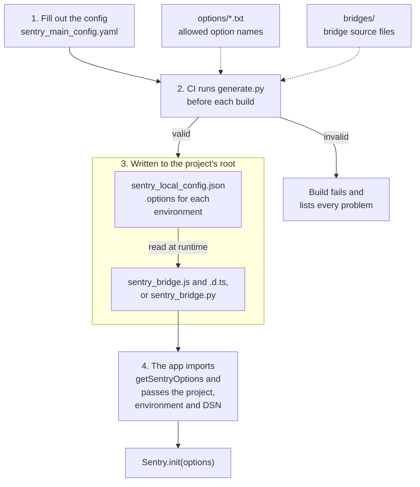

# Central Sentry config

One Sentry SDK config for every repo: teams start from the same baseline, and a change reaches each app with its next build. A reference implementation, not an official Sentry feature.

## How it works



1. `sentry-config/sentry_main_config.yaml` holds the defaults and one block per app.
2. Before each build, the app's pipeline runs `generate.py --project <name>`. It checks the whole config and fails the build on any problem.
3. It writes the app's resolved options into the app's `root`, next to a copy of the bridge.
4. The app passes `getSentryOptions(...)` to `Sentry.init`. The bridge picks the environment's options at runtime.

Platforms: `python`, `django`, `javascript-browser`, `react` and `next-js` (client side). The option lists in `sentry-config/options/` match `sentry-sdk` 2.74 and the JavaScript SDKs 11.11.

## Try it

```
python3 -m pip install -r sentry-config/requirements.txt
python3 sentry-config/generate.py --check
python3 sentry-config/generate.py --project web-app --release 1.0.0
```

The last command writes into `examples/web-app/src/`, next to the example app's init file.

## Setting it up

### The central repo

Copy `sentry-config/`, and replace the example defaults and projects in `sentry_main_config.yaml` with your own. To keep the tests, copy `tests/`, `package.json`, `package-lock.json`, `requirements-dev.txt`, `pytest.ini` and `vitest.config.js` too.

Run `python3 sentry-config/generate.py --check` and the tests on every change, as `.github/workflows/check.yml` does. Make it a required check, because a broken config fails every app's build.

### Each app repo

1. Add the app's block to the central config. It needs a `root` (where the files go, relative to the app repo's root) and a `platform`.
2. Add this step to the pipeline, before the build. Run it from the app repo's root. It needs Python 3 and read access to the central repo. Developers run the same step before running the app locally.

   ```sh
   config=$(mktemp -d)
   git clone --depth 1 --branch main <central config repo> "$config"
   python3 -m pip install -r "$config/sentry-config/requirements.txt"
   python3 "$config/sentry-config/generate.py" --project <name> --release <version>
   ```

3. Gitignore `sentry_local_config.json`, `sentry_bridge.js`, `sentry_bridge.d.ts` and `sentry_bridge.py`.
4. Initialize Sentry through the bridge. Import `Sentry` from the package the app uses: `@sentry/browser`, `@sentry/react` or `@sentry/nextjs`. Next.js apps do this in `instrumentation-client.ts`.

   ```js
   import * as Sentry from "@sentry/browser";
   import { getSentryOptions } from "./sentry_bridge.js";

   Sentry.init(getSentryOptions("web-app", environment, dsn, { beforeSend }));
   ```

   ```python
   from sentry_bridge import get_sentry_options

   sentry_sdk.init(**get_sentry_options("api", environment, dsn, before_send=before_send))
   ```

   Pick the environment at runtime, as `examples/web-app/src/instrument.js` does, so a build promoted from staging to production reports as production.

## Moving an existing app over

1. Move each option the app passes to `Sentry.init` into its project block, or drop it where the defaults already cover it.
2. Keep callbacks, samplers and integrations that take functions, such as React Router's, in code. They go in the last argument.
3. The app still passes `dsn` and `environment`. The `release` comes from `--release`.

If code still sets a value the config also sets, the bridge logs a warning, so leftovers show up in the console.

## Writing the config

- **Layers.** Each environment's options are built from `default.shared`, `default.environments.<env>` and `default.native.<platform>`, then from the project's `shared`, `environments.<env>` and `native`. Later layers win.
- **Merging.** Maps merge and single values replace. Lists append, so a project can't remove an entry it inherits.
- **Shared and native options.** Shared options use snake_case and are converted to each SDK's names. A platform without the option doesn't get it. Native options use the SDK's own names and apply after environments, so keep per-environment values, like sample rates, in `environments`.
- **Patterns.** In JavaScript, a string matches anywhere in the message, and `{regex: "..."}` becomes a `RegExp`. In Python, `ignore_errors` matches exception class names, not patterns.
- **Integrations.** A map of names to options. In JavaScript, `replay` builds `replayIntegration()`; in Python, `django.DjangoIntegration` is the class under `sentry_sdk.integrations`. Use `{}` for default options, and `false` to turn off an integration the SDK adds by default.
- **Checks.** Every build checks every project, plus a new project on each platform in `default.native`. Generate fails on:
  - unknown or deprecated options, suggesting the closest name
  - lists written as a single value, and invalid regexes
  - misnamed integrations
  - browser sample rates whose integration is missing

## Tests

```
python3 -m pip install -r requirements-dev.txt && npm install
pytest && npm test
```

- `tests/python/test_generate.py` covers the merge rules and every validation message. It also compares generated output with `tests/fixtures/expected/`. When that output changes on purpose, run `UPDATE_GOLDEN=1 pytest` and review the diff.
- `tests/python/test_bridge.py` and `tests/js/` run each bridge against the real SDK, recording what would be sent rather than sending it. They also type-check the TypeScript types file.
- `tests/python/test_across_repos.py` runs the pipeline step above exactly as written, in an app repo separate from a central repo.
- The option-list tests fail if a name in `sentry-config/options/` doesn't exist in the installed SDK. To check the version your apps use, install it and rerun:
  - `python3 -m pip install sentry-sdk==<version> && pytest`
  - `npm install -D @sentry/browser@<version> && npm test`

  Update the lists when your apps move to a new SDK major version.
