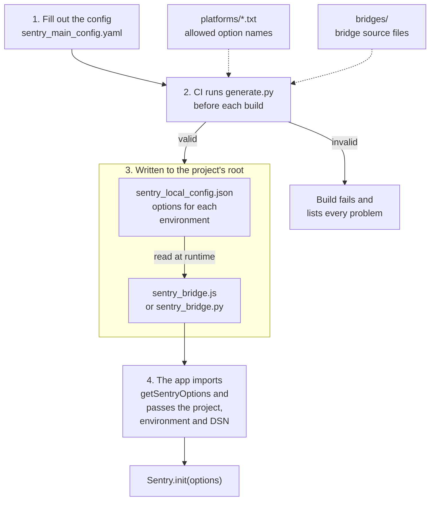

# Central Sentry config (prototype)

A reference implementation of a centralized Sentry config. This is not an official Sentry feature.

## How it works



1. **Fill out the config.** `sentry-config/sentry_main_config.yaml` holds the defaults plus one block per project. Each project block sets its `platform` and its `root`, the folder that gets the generated files.
2. **CI runs `generate.py`** for the project being built. It checks the whole config against the allowed option names in `sentry-config/platforms/`, and fails the build if anything is wrong. The lists match `@sentry/browser` and `@sentry/react` 11.11 and `sentry-sdk` 2.74. Keep one set per SDK major version.
3. **It writes two files into the project's `root`.** `sentry_local_config.json` holds the project's resolved options for every environment. The bridge is a copy from `sentry-config/bridges/`: `sentry_bridge.js` for `javascript-browser`, `react` and `next-js` (client side), or `sentry_bridge.py` for `python` and `django`.
4. **The app imports `getSentryOptions`** (`get_sentry_options` in Python) from the bridge and passes its project name, environment and DSN. The bridge picks that environment's options at runtime, so a build promoted from staging to production uses production values. The DSN comes from the app, not the config. See [In a project](#in-a-project).

Also in this repo: `examples/` has sample init files for a browser app and a Python service, and `tests/` has the test suite (see [Tests](#tests)).

## Try it

Run from this folder (paths in the YAML are relative to it):

```
pip install pyyaml
python sentry-config/generate.py --project web-app --release 1.0.0
python sentry-config/generate.py --project api --release 1.0.0
```

Each command writes `sentry_local_config.json` and a bridge into the project's `root`. The generated files are gitignored, so run the same command in CI before each build, and locally before running a project. Pass `--config <path>` to use a config file somewhere other than `sentry-config/sentry_main_config.yaml`.

If the config is invalid, the command prints every problem and exits with status 1, which fails the build.

## In a project

JavaScript:

```js
Sentry.init(getSentryOptions("web-app", environment, dsn, { beforeSend, integrations: [...] }));
```

Python:

```python
sentry_sdk.init(**get_sentry_options("api", environment, dsn, before_send=..., integrations=[...]))
```

The last argument is optional. Use it for callbacks, samplers and integrations that can't be written as data.

The JavaScript bridge imports the project's SDK: `@sentry/browser`, `@sentry/react` or `@sentry/nextjs`. Call `init` from the same package.

- **React:** React Router tracing integrations take router functions, so pass them in code. They replace the configured `browserTracing` because they share its name.
- **Next.js:** client side only. Import the bridge from `instrumentation-client.js`. `@sentry/nextjs` adds `browserTracing` on its own, so the config doesn't need to list it.

## Tests

```
pip install -r requirements-dev.txt
npm install
pytest       # generator, Python bridge, Python option list
npm test     # JavaScript bridge, JavaScript option list
```

The suite has three parts:

- **Generator** (`tests/python/test_generate.py`): merge rules, per-platform resolution, every validation error, and the command line. The full output for each project in `tests/fixtures/config.yaml` is compared against the snapshots in `tests/fixtures/expected/`. It also loads the bridge from the folder `generate.py` wrote, so a filename mismatch between the two fails the suite.
- **Bridges** (`tests/python/test_bridge.py`, `tests/js/*.test.js`): each bridge is loaded the way a project gets it, next to an expected snapshot, and run against the real SDK (`sentry-sdk`, `@sentry/browser`, `@sentry/react`). The tests check what the bridge returns, what the SDK ends up configured with, and what it actually sends: ignored errors are dropped, a sample rate of 0 sends nothing, a rate of 1 sends everything, and callbacks passed in code run. A test transport records what would be sent, so nothing leaves the machine. `@sentry/nextjs` isn't installed because it pulls in Next.js.
- **Option lists** (`tests/python/test_option_lists.py`, `tests/js/option-list.test.js`): check every name in `sentry-config/platforms/` against the installed SDK. The JavaScript check type-checks the names against the SDK's `BrowserOptions` type, because the JavaScript SDK ignores unknown options without any warning. React and Next.js client `init` take that same type.

The JavaScript tests read the snapshots in `tests/fixtures/expected/`, which the Python tests prove match the generator's output. So the JavaScript tests don't need Python installed.

### When the generator's output changes on purpose

Regenerate the expected snapshots, then review the diff before committing:

```
UPDATE_GOLDEN=1 pytest
```

### Testing other SDK versions

The pinned versions in `requirements-dev.txt` and `package.json` match the option lists. To check a version your projects use, install it and rerun the suite:

```
pip install sentry-sdk==<version> && pytest
npm install -D @sentry/browser@<version> @sentry/react@<version> && npm test
```

A failing option-list test means an option was renamed or removed in that version. Keep a separate option list for each SDK major version you support.
